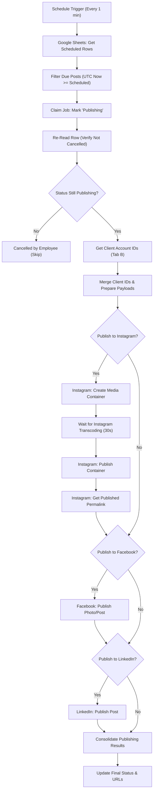

# Multi-Client Social Media Automation Pipeline (Instagram, Facebook & LinkedIn)

An automated social media scheduling and publishing pipeline built in **n8n**, integrated with **Google Sheets**, **Meta Graph API** (Instagram & Facebook), and **LinkedIn UGC API**.

---

## 🚀 Key Features

- **Google Sheets as Headless CMS**: Schedule posts across multi-client accounts using a structured Google Sheet.
- **Multi-Platform Publishing**:
  - **Instagram**: Two-step publishing pipeline (Media Container creation $\to$ 30s Transcoding Wait $\to$ Publish Container $\to$ Public Permalink retrieval). Supports both Images and Reels.
  - **Photo Tagging (Instagram)**: Tag public Instagram accounts directly on images via standard `user_tags` coordinates.
  - **Facebook**: Posts photos or feed updates directly to the connected Facebook Page.
  - **LinkedIn**: Formatted UGC (User-Generated Content) publishing for personal profiles or company organizations.
- **Strict Sequential Flow**: Eliminates race conditions and duplicate retries across all platforms.
- **Smart Google Drive Conversion**: Automatically converts standard Google Drive share links into raw streaming image URLs for Meta and LinkedIn ingestion.
- **Time Zone-Aware Scheduling**: Evaluates publication dates/times against any client timezone (e.g., `Asia/Kolkata`, `America/Los_Angeles`, `UTC`).
- **Live Clickable Blue Links**: Updates the Google Sheet with direct clickable links (`=HYPERLINK` format) to verify published posts instantly.

---

## 📊 Google Sheets Structure

### 1. Tab A: `Content Calendar`
| Column | Description | Example |
| :--- | :--- | :--- |
| `Post ID` | Unique identifier | `POST-001` |
| `Client Name` | Matches client in Tab B | `Webtrionix techno` |
| `Content Name` | Short descriptive name | `AI Future` |
| `Media URL` | Direct image link or Google Drive share URL | `https://drive.google.com/file/d/...` |
| `Photo Tags` | Optional Instagram usernames to tag on the photo | `@ciflow904, @webtrionix` |
| `Instagram` | `Yes` or `No` | `Yes` |
| `Facebook` | `Yes` or `No` | `Yes` |
| `LinkedIn` | `Yes` or `No` | `No` |
| `Instagram Caption` | Platform-specific caption | `AI is shaping our digital future...` |
| `Facebook Caption` | Platform-specific caption | `Check out how AI empowers workflows!` |
| `LinkedIn Caption` | Platform-specific commentary | `The future of enterprise technology.` |
| `Scheduled Date` | Date of release | `2026-10-24` |
| `Scheduled Time` | 12-hour or 24-hour time | `11:30:00 AM` |
| `Time Zone` | Client time zone | `Asia/Kolkata` |
| `Status` | `Scheduled`, `Publishing`, `Posted`, or `Failed` | `Scheduled` |
| `Published URL` | Auto-populated by workflow | Clickable links to live posts |
| `Error Message` | Error logs if publishing fails | (Empty on success) |

---

### 🏷️ Photo Tagging Usage
In Tab A (`Content Calendar`), you can add a column named **`Photo Tags`** (or **`Instagram User Tags`**).
- Format: Enter comma-separated or space-separated handles (with or without `@`):
  `@ciflow904, @webtrionix` or `ciflow904, webtrionix`
- Supports tagging up to 20 public accounts per image post.
- The pipeline automatically computes balanced coordinates `(x, y)` so tags are neatly distributed across the photo.
- If left empty, the post publishes normally without tags.
- Video posts (Reels) ignore photo tags gracefully without causing errors.

---

### 2. Tab B: `Clients`
| Column | Description | Example |
| :--- | :--- | :--- |
| `Client ID` | Unique Client Code | `CLI-001` |
| `Client Name` | Client Name | `Webtrionix techno` |
| `Instagram Account ID` | Instagram Business Account ID | `17841439037630316` |
| `Facebook Page ID` | Facebook Page ID | `1454740611044963` |
| `LinkedIn Organization ID` | LinkedIn Person URN or Org ID | `7jngID0YwF` |
| `Time Zone` | Default Time Zone | `Asia/Kolkata` |
| `Active` | Status | `Yes` |

---

## 🔄 Workflow Execution Order

---

## 🛠️ How to Import into n8n

1. Open your n8n workspace (e.g. `http://localhost:5678`).
2. Click **Add workflow** $\to$ **Import from file...**
3. Select `social_media_automation_workflow.json`.
4. Connect your credentials:
   - **Google Sheets OAuth2 API**
   - **LinkedIn OAuth2 API**
   - **Meta Access Tokens** (Page Access Token and User Token)
5. Toggle the workflow to **Active**.

---

## 📄 License
MIT License.
